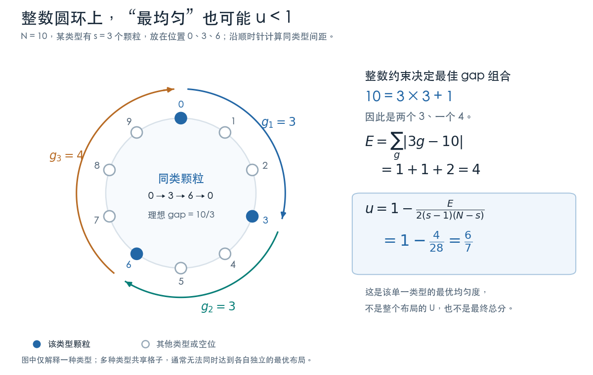
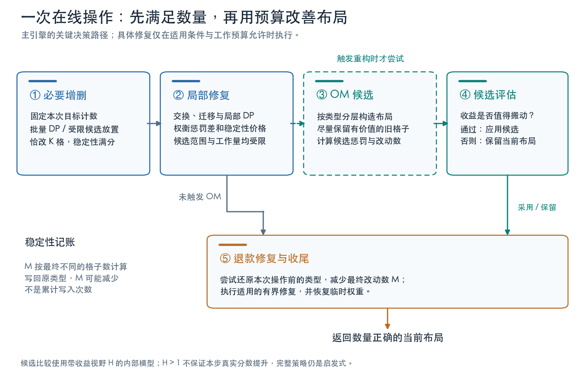

# 固定时隙均匀分配：从局部增量到保留重叠的全局重建

这道题要求在线维护一个环形时隙表：每次增加或删除某个服务的一批颗粒，在数量正确的前提下，让服务分布尽量均匀，同时尽量少动已经部署的格子。

本文解释一套完整的混合启发式引擎。它包括批量安放的链式动态规划、带稳定性价格的局部搜索、保留旧位置的分层重建、初始化搜索，以及极小规模上的分支定界。各模块共享同一组环形间隔代价和增量索引，而不是彼此无关的多份解法。完整实现见 [代码](../src/solution.cpp)。

题解先说明目标如何建模，再介绍候选如何生成，最后解释这些模块如何组成一次操作。阅读代码时，可以先看 `processOperation` 和初始化入口，再按本文顺序下钻。

## 1. 问题与两个质量目标

圆环有 N 个位置，下标为 `0..N-1`。位置中的非零整数是服务 ID，0 表示空位；空位也作为一种类型参与均匀度评价。

增加服务 x 的 K 个颗粒，至少要将 K 个空位改成 x；删除则相反。允许移动其他颗粒，但会影响稳定性。每步质量部分是

```math
J=0.55U+0.35V.
```

其中 U 是布局均匀度，V 是稳定性。官方还包含速度分，因此质量更高但工作量过大的算法，综合结果可能更差。

本题没有唯一正确排列，也没有一个容易直接求出的全局最优在线策略。我们的目标是构造足够强的候选，并用统一的质量模型和工作预算做取舍。

## 2. 将均匀度转成整数 gap 代价

类型 t 有 s 个颗粒。沿圆环顺序，记相邻同类型颗粒之间的正向距离为 g；最后一个到第一个的距离也要计算，所有 gap 的和为 N。只有一个颗粒时，它到自身的一周距离是 N，不能写成 0。

题面的偏差为

```math
D_t=\sum_g\left|g-\frac Ns\right|.
```

引入整数偏差

```math
E_t=\sum_g|sg-N|=sD_t.
```

当 2≤s<N 时，类型均匀度可以写成

```math
u_t=1-\frac{E_t}{2(s-1)(N-s)}.
```

再乘该类型占整个网格的比例 s/N，得到

```math
1-U=\frac1{2N}\sum_{t:\,2\le s_t\lt N}
\frac{s_tE_t}{(s_t-1)(N-s_t)}.
```

数量为 0、1 或 N 的类型需要单独处理：空类型没有权重，后两种情况按题面得满分，内部代价系数置零。

实现使用整数权重和总代价

```math
F_t\approx\frac{256s_tN}{(s_t-1)(N-s_t)},
\qquad P=\sum_tF_tE_t\approx512N^2(1-U).
```

`setType` 构造类型权重；`cst` 计算裸 gap 代价，`wcst` 计算加权 gap 代价；`totalLayoutPenalty` 求整个布局的内部损失。整数除法带来定点舍入，因此这里使用近似符号。

还有一个容易误解的边界：整数格子上的最均匀分布不一定得到 u=1。若 N=qs+r，最均衡的间隔是 s−r 个 q 和 r 个 q+1，对应

```math
E_t^{\min}=2r(s-r).
```

例如 N=10、s=3，间隔 3、3、4 已经最均衡，该类型均匀度仍只有 6/7。



## 3. 稳定性与每个额外格子的价格

令 K 为本次实际成功增删的数量，M 为最终与本次操作开始前不同的位置数。N>K 时

```math
V=1-\frac{M-K}{N-K}.
```

所以先只修改 K 个必要位置，就有 M=K、V=1。这是所有复杂搜索之前的可靠基线。N=K 时按题面直接取 V=1，避免除以零。

后续交换不改变类型数量，却可能增加或减少 M。对格子 i，内部保存本次首次修改前的类型；再次写入时与这个原类型比较。把格子改回原类型能够退还稳定性成本。

因此 M 既不是写入次数，也不是交换次数。交换 p、q，当前类型为 a、b，操作入口类型为 O 时，改动数差值为

```math
\Delta M=[b\ne O_p]-[a\ne O_p]
          +[a\ne O_q]-[b\ne O_q].
```

代码通过 `markChange`、`changedNow`、`changedIf` 和 `stabD` 维护这套记账。时间戳避免每次清空全部辅助数组；只有属于当前操作的记录才会被读取。

### 为什么使用前瞻 H

一次额外搬动立刻付稳定性成本，但更均匀的状态可能延续若干步。算法用 H 表示预期受益时长，将一个候选的内部价值写成

```math
\Delta P+\lambda_H\Delta M,
\qquad
\lambda_H\approx
\frac{7\cdot512N^2}{11H(N-K)}.
```

负值表示改善这个模型。H 越大，算法越愿意为布局质量支付搬动成本。`currentHorizon` 根据已处理的调用数逐渐增加前瞻，再施加上限；不同搜索阶段还会使用各自的前瞻上限和预算。

这是启发式预期，不是对未来操作的已知信息。H>1 时，接受的动作可能降低本步真实 J。部分阶段还会调整空位的权重，因此不能把所有内部下降都解释成官方即时分数的严格提升。

## 4. 让复杂搜索可运行的增量索引

外部服务 ID 不要求连续。代码用映射将其压缩成内部类型编号，维护以下状态：

- 当前网格、每种类型的数量，以及外部 ID 与内部编号的对应关系。
- 非空位类型的环形双向链，快速获得一个颗粒的同类型前后邻居。
- 空位位图及非空字摘要，快速查询附近空位、前后空位和窗口候选。
- 类型位图，支持按位置顺序批量收集某类颗粒。
- 类型代价表、总损失缓存，以及标记哪些类型需要重算的 dirty 状态。
- 当前操作的修改记账、局搜种子队列与工作预算。

移动一个颗粒只影响其移除和插入处附近的 gap。总损失的计算也不必每次重新遍历所有类型；未变化类型可以复用缓存。

实现保留当前状态及固定大小的预算统计，不保存完整的过去请求序列或过去多幅布局。

## 5. 强制增删：同时照顾服务与空位

先看最简单的局部差值。在一个类型的相邻颗粒之间插入 p，把一个 gap a+b 拆成 a、b。定义 f_s(g)=|sg−N|，则

```math
\Delta E_{\mathrm{insert}}=f_s(a)+f_s(b)-f_s(a+b).
```

删除的变化恰好相反。插入空集合的第一个颗粒时增加 f_s(N)；删除最后一个颗粒时减去 f_s(N)。

增加 x 的一个格子，会同时向 x 插入一点、从空位集合删除一点。因此选点代价包含服务与空位两部分，不能只把 x 放进自己的最长 gap 而完全忽略剩余空位。

`placeAddedGranules` 和 `selectRemovedGranules` 是强制阶段入口。基础路径在目标位置附近的有限窗口查找合法颗粒，比较完整的局部模型；批量较大时则进入下面的动态规划。

### 批量操作必须固定最终计数

一次增加 K 个颗粒时，先确定最终的 s'=s+K 和 e'=e−K。K 次选点中始终使用这两个数量构造 gap 目标与权重。

如果每选一个点就按中间数量重新定义理想 gap，其余所有间隔的代价也会改变，仅计算插入点附近的三项差值便不再完整。固定最终计数后，中间状态只是搜索势函数，最终状态才对应本次操作的目标。

填满全部空位、删除整个类型等情况有直接的批处理路径；一般情况下，强制阶段只在来源类型与目标类型之间改色，恰好改变 K 个不同格子。

## 6. 批量增加的配额分配与链式 DP

批量增加不能简单地重复 K 次互不关联的最近空位选择：多个新点可能共享同一个旧 gap，前面的选择会影响后面的间隔。`placement_dp` 将它分成“分配数量”和“协同选位置”两层。

### 6.1 先决定每个旧 gap 放多少点

已有类型 x 的旧颗粒固定。旧 gap 长度为 g，放入 k 个新颗粒后得到 k+1 段；理想段数约为 s'g/N。

初始取 k≈floor(s'g/N)−1，并夹到该 gap 的空位容量范围。取整后总数可能不等于 K，于是按余数或欠额继续补回、扣回名额，直到满足总数。这是带容量限制的 Hamilton 配额思想。

实现还会用空位供给调整配额倾向，避免某段长度很大却几乎没有合法空位。数量分配是启发式；后续每段有 DP，并不代表跨段配额已经全局最优。

入口为 `placement_dp::addExisting`。新类型没有固定旧颗粒，`addNewType` 会尝试少量相位和锚点，将圆环展开成首尾相接的一条链。

### 6.2 状态、转移与回溯

考虑固定端点 S、T 之间插入 k 个点。在 k 个近似等距目标附近各取一个候选带，保持候选按真实位置递增。

记第j层候选集合为 $`C_j`$，$`p_u`$ 为候选u的真实展开位置。状态 $`DP_j(u)`$ 表示前j个新颗粒已经确定，最后一个选在候选u的最小模型代价；不同层候选带可重叠，前驱必须满足位置严格递增：

```math
DP_j(u)=n(u)+\min_{\substack{v\in C_{j-1}\\p_v\lt p_u}}
\{DP_{j-1}(v)+f_x(p_u-p_v)+c(v,u)\}.
```

这里 f_x 是服务 gap 的加权边代价，n(u) 是填掉该空位的节点代价，c(v,u) 修正两个相邻旧空位同时被填掉时的相互影响。首尾边连接固定端点；保存最优前驱后统一回溯所有位置。

相关函数是 `buildTargets`、`solveSeg`、`chainW` 和 `denseChain`。选点完成后批量写入并重连类型链，避免反复维护大量临时链结构。

空位节点使用一个折线函数表示。若最终空位数为 e'，定义

```math
\rho(g)=2C_0\max(N-e'g,0).
```

去掉一个两侧 gap 为 a、b 的旧空位，其形状相关项为 ρ(a+b)−ρ(a)−ρ(b)。绝对值展开中的线性项，在固定 K 的方案比较中是常数，可以略去。代码中的 `rh0`、`nodeCost` 与 `pairCost` 对应这些项。

服务侧链间隔可以直接准确累计；空位侧采用节点和相邻对交互模型。它不能无条件精确表达任意长度连续多填时的完整空位评分。DP 的最优性限定在给定配额、候选带和这个代价模型之内。

### 6.3 利用 V 形边权加速

服务边权形如 |s'(p_u−p_v)−N|。将位置线性变换为 Y(p) 后，转移可按绝对值折点分成两段，维护前缀最小值和单调队列，避免遍历所有前驱。

一般候选带宽 W 的朴素 DP 为 O(kW²)；适用该优化的链路径约为 O(kW)。窄带版本则直接展开固定宽度转移，用较小常数替代复杂维护。相邻旧空位的特殊修正单独处理。

## 7. 批量删除：选择留下来的晶格

删除 K 个 x 等价于从原有 s 个位置中选择 s−K 个留下。这种表述可以直接控制删除后服务的完整间隔。

`placement_dp::removeLattice` 围绕剩余颗粒的近似均匀目标，在原颗粒列表上取候选带；状态表示已经选择若干保留点及最后一个候选。相邻保留点的距离提供服务边权，它们之间未保留的位置变成空位，相关项通过节点或前缀量累计。

最后统一释放所有未被选中的位置。`latticeDP` 及其窄带特化共享这条保序选择主线。

这里同样有锚点、带宽和空位交互模型的限制。它比逐颗粒孤立删除更有协同性，但不是任意批量删除的全局精确解法。

## 8. 强制阶段之后的稳定性定价搜索

### 8.1 快速种子局搜

`runLocalSearch` 从本次改点及同类型邻居出发，尝试将颗粒移向合并 gap 的中点附近。移动通过交换实现，候选价值包含双方类型的 gap 变化和 λ_HΔM。

接受后，把同类型邻接关系发生变化的格子重新放入种子队列。这是一种工作量较小的局部修复，不需要遍历全部位置对。

### 8.2 MN：更强的伙伴搜索

`mnRun`、`mnDescent` 和 `mnBestX` 扩大候选范围。源点来自本次改点、操作类型颗粒及其他有潜力位置；伙伴包括近邻窗口、合并 gap 中点、大 hole 中点，以及能恢复本次入口原类型的位置。

先用“本类型最好可能移动 + 稳定性价格”的下界过滤，再对有希望的源点寻找最好伙伴。每次接受后增量更新邻居缓存、hole 列表与队列。

下界剪枝能省去不可能改善当前模型的评估；候选窗口本身仍然是限制。每操作信用桶、评估上限和交换上限控制工作量。

`sqPre` 在重建检查前先做一轮较广的搜索：如果能便宜地消除局部缺陷，就可能省掉一次昂贵重建。搜索顺序会影响后续触发，因此不能随意交换这些阶段的位置。

### 8.3 保序重排与空位修复

`relat` 把一种类型的颗粒按圆环顺序编号，每个颗粒在窄位移带中选新位置。DP 用 gap 边权连接相邻新位置，节点包含交换伙伴代价与稳定性价格，同时约束顺序不交叉。

`vcRelat0` 将活跃空位限制在固定空位之间的连续段上；`relx4` 在“服务 x + 空位”的有序列表中重新选择哪些位置属于 x。这些方法比独立交换更能协调一段布局。

删除后的回填与新增位置的重新选择，则利用同一步内已经付过的改动成本。它们遵守同一原则：改动价格由操作入口与最终布局的差异决定，不能固定认为每次搬动都额外改变两个格子。

## 9. OM：保留旧位置的分层重建

局搜可能困在局部极值，多类型也可能同时碎片化。全局重建能带来新的排列，但直接套一个均匀模板会破坏大量旧位置。OM 的目标是同时得到较好的分层布局，并尽量保留有价值的重叠。

入口是 `buildOverlapReconstruction`；它只生成候选，是否真正采用由外层流程判断。

### 9.1 从固定 DDA 轨迹变成带宽 DP

按类型规模顺序处理，每层从前面类型尚未拿走的位置中选 s 个。剩余列表长度为 L 时，理想秩间隔约为 floor(L/s) 或再加一。

普通 DDA 固定这些间隔的先后次序。OM 则围绕理想秩轨迹维护小幅漂移状态，由 DP 选择次序；也可以允许略小或略大的间隔，并付偏差代价。

节点奖励“选到这个类型原本占据的位置”，并惩罚抢走其他已经放得较好类型的格子。命中奖励由稳定性价格导出，局部良好标记由相邻 gap 判断。

因此，重叠最大化是设计目标，而不是对所有合法布局的无条件最大重叠证明。候选还受到层顺序、漂移带宽与 gap 代价约束。

### 9.2 dense 与 sparse 两种层

dense 层在较紧凑的剩余列表上选择，主要使用秩间隔偏差，并及时压缩列表。sparse 层使用带 blocked 标记的共享列表，必要时再压缩，边权更多使用真实圆环距离。

`omLayerDense`、`omLayerLazy` 和 `omDP`/`omDPS*` 实现这些分支。固定带宽的展开版本只是同类递推的加速形式。秩距离不等于物理距离，因此也不能声称所有层都精确优化原始 U。

### 9.3 keep-DP 与 good 标记释放

`omKeepDP` 给旧布局另一个机会：以旧位置为中心，只开放被前层阻挡部分附近的位移，其余位置尽量保留，再与新晶格候选比较。

一个类型完成本层分配后，其未使用旧位置不应继续依靠 good 标记妨碍后续类型。因此要释放相关保护。还可以尝试少量不同的命中奖励，按统一净值选择较好的重建候选。

### 9.4 触发与接受是两件事

触发决定是否值得花时间生成候选。算法根据当前 P、各类型独立最均衡的下界、上次修复后残留的缺陷，估计布局恶化程度；再配合最小检查间隔、大操作条件和工作信用控制成本。

`minimumPossiblePenalty` 是独立类型下界之和。它不一定能由一个共同布局达到，所以不能将“当前值减去这个下界”直接理解为全部可恢复收益。

候选生成后，重新累计内部损失和真实改动数增量。普通重建路径首先要求 $`P_{\mathrm{current}}>P_{\mathrm{candidate}}`$，再检查稳定性净值。典型接受条件为

```math
11H_A(N-K)(P_{\mathrm{current}}-P_{\mathrm{candidate}})
>7\cdot512N^2\Delta M.
```

这里 ΔM 是候选相对当前方案的 M 增量，但 M 始终相对本次操作入口计算；它不是当前图到重建图的简单 Hamming 距离。

通过后由 `applyReconstruction` 落盘。接受条件使用前瞻 H_A 和内部权重，因此是收益模型的测试，不是官方即时 J 单调改善的通用保证。

## 10. 大操作后的链修正与移动成本返还

`rbxFar` 从删除释放的格子寻找更远的合适回填伙伴；`vpmLmp` 和 `hcRevertLS` 重点查找能恢复入口类型、返还移动成本的交换。它们补充了只看近邻几格容易漏掉的机会。

大型批量增加后，若一串新增 x 颗粒都受可用空位限制而偏离理想位置，`zchRuns` 将旧 x 颗粒作为锚点，把相邻新增点分成若干 run。

每个新增点可以在窄位移带内与其他类型或空位交换；run-DP 用相邻新位置的 x gap 作边权，用伙伴代价与稳定性变化作节点，约束整条链不交叉，再回溯执行。`zchPass` 提供较轻的逐点修正路径。

这些修正仍是启发式：多个伙伴动作可能互相影响，且稳定性使用前瞻定价。大操作强化还受到体量门限、累计工作量和预算约束，不能理解为每步都执行完整的大范围搜索。

## 11. 初始化：多构造、IQ 搜索与保留最好候选

初始化没有移动惩罚，也不在官方头文件说明的 apply/grid 计时范围内，但仍需要合理的资源上限。

`buildInitialLayout` 先按类型数量分层，在当前剩余位置列表上用整数 DDA 精确分配数量。每层累计器加 s，达到或超过列表长度 L 就选中并减 L；一遍扫描恰好选择 s 个位置。

随后尝试无命中偏好的 OM 构造及少量层顺序变体，保留损失较低者，再做纯均匀度局搜。

IQ 阶段包括两种互补搜索：

- `polishInitialLayout`：队列局搜，尝试局部窗口和同类型合并 gap 的中点，接受后重新排队受影响邻居。
- `annealInitialLayout`：阈值接受搜索，允许小幅上坡以越过局部极值，逐渐降低阈值，之后再做局搜并保存最好布局。

阈值接受不使用 Metropolis 的指数概率。随机化只负责生成普通搜索候选；随机流在初始化时重置，以便复现实验。

初始化中的 best-so-far 只是在当前构造过程内比较候选，不是保存在线历史请求。它保证保留已见候选中的较好布局，不构成全局最优证明。

## 12. 极小规模：完整模型与有预算的分支定界

普通引擎已经包含较小圆环的广范围交换搜索。极小 N 则由独立的 `tiny_search` 引擎处理，使用更高精度的定点目标和更完整的搜索。

每次先完成数量正确的强制修改，再执行全位置对局搜，最后进行分支定界。搜索逐格指定类型，同时满足最终数量。

下界来自两个方向：剩余长度均分给剩余同类型 gap，得到凸代价的乐观下界；剩余类型配额无法复用全部旧位置时，加入不可避免的改动数。已经得到的好布局作为 incumbent，帮助尽早剪枝。

搜索有节点上限，因此不能保证所有输入都完成穷举。更准确的说法是：在有限预算内，使用合法下界和精确的内部目标寻找改进。即使该内部目标被完全求解，H 的前瞻假设也不等于真实未来平均质量的最优性证明。

## 13. 一次操作的完整阅读路线



`processOperation` 的主线可以概括为：

1. 确定实际增删量、阶段预算、前瞻价格与本次修改记账。
2. 完成强制增删，必要时用批量 DP 协调位置。
3. 执行有预算的种子局搜、类型或空位重排及大操作修正。
4. 在重建检查前做适用的预搜索，估计是否需要 OM。
5. 若值得，生成并评估保留重叠的重建候选，接受后落盘。
6. 做适用的退款修复、MN 搜索与收尾，恢复临时权重。

具体模块会按规模、操作大小和预算选择性执行。`configureWorkBudgets` 集中承担这种成本取舍；这些档位和常数是工程启发式，不是评分公式唯一推导出的值。

## 14. 复杂度、算术约束与适用边界

混合引擎不能用一个 O(N log N) 掩盖全部工作。更有用的描述是按阶段列出成本：

- 强制链 DP：长度 k、候选带宽 W，朴素转移 O(kW²)，适用 V 形优化的路径约 O(kW)，另有扫描与配额分配。
- 保序重排：长度 s、位移带宽 O(w)，一般为 O(sw²)；活跃段版本用活跃长度替代 s。
- OM：多层窄带 DP，加上剩余列表维护、压缩和最终候选评估。
- 局搜：每次只评估少量 gap，但总次数受候选窗口、信用桶与工作上限控制。
- 极小图分支定界：最坏指数级，依靠规模门限、下界和节点预算封顶。

题面限制乘除、取余、浮点和数学库。实现使用移位加法、二进制长除法、整数表和比较；环形下标用加减 N 归一化。固定宽度展开、位图扫描、增量缓存和容器访问优化降低了这些操作的常数。

代价模型、搜索空间和性能预算是三个不同层面：局部 delta 可以在内部模型下准确，DP 可以在候选带内最优，但完整在线策略仍是启发式。其效果应通过数量守恒、独立评分、局部差值核对、边界输入和实际耗时分别验证。

这套方法的价值在于形成了一个闭合系统：批量 DP 减少首次安放的缺陷，局搜修复局部问题，OM 提供跨越局部极值的候选，稳定性记账约束额外移动，而初始化与工作预算让这些能力能够持续使用。
